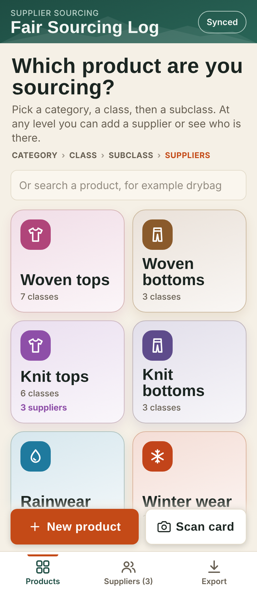
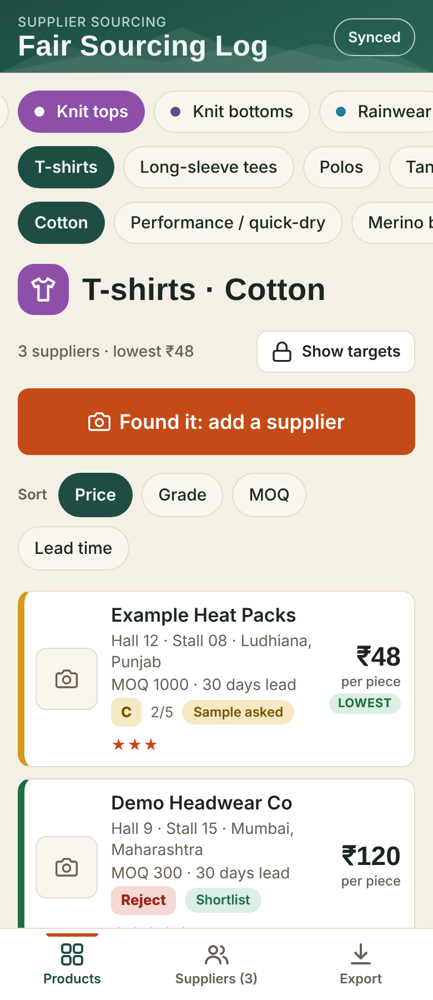
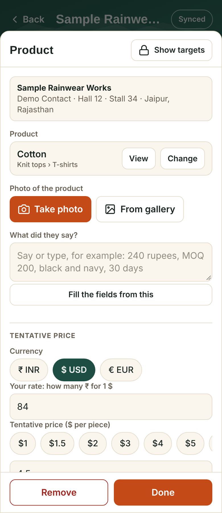

# Fair Sourcing Log

A phone app for a buyer who is sourcing at a trade fair or on supplier visits.

Pick the product (Category > Class > Subclass), tap **Found it**, photograph the supplier's card and the product, and capture the **tentative price** (₹, $ or €, with the price basis and a price break), the **MOQ**, lead time, samples, spec and a **buyer grade** (A / B / C / Reject with quality, price, fit and reliability scores). The product screen then shows every supplier side by side, sortable by price, grade, MOQ and lead time.

Everything is saved **on the phone**, works with no signal, and exports to **Microsoft Lists** (Products, Suppliers and Quotes) for your PLM.

This folder is the whole app. It contains no suppliers, prices or targets: only the empty product list.

## Screens

| Pick a product | Suppliers compared | The buyer's sheet |
|---|---|---|
|  |  |  |

The screens show invented demo suppliers.

## Files

| File | What it is |
|---|---|
| `index.html` | The app |
| `shim.js` | Saves data and photos on the phone (IndexedDB) |
| `sw.js` | Lets the app open with no signal |
| `onedrive.js`, `onedrive-config.js` | Optional OneDrive sync (hidden until a client ID is pasted into `onedrive-config.js`) |
| `manifest.webmanifest`, `*.png` | Name and icons for the home screen |

## Put it on your phone

An app can only be installed from a secure (`https`) address. Pick one:

**A. Netlify, about two minutes, free.** Go to <https://app.netlify.com/drop> and drag this folder (or the ZIP) onto the page. You get an address like `https://something.netlify.app`. Open it on your phone.

**B. GitHub Pages, free.** Create a repository, upload these files to its root, then Settings > Pages > Deploy from branch > `main` / root. Open `https://<your-name>.github.io/<repo>/`. A free GitHub account needs the repository to be public. That is fine: the app holds no data, but do not add your own data or targets to the repository.

**Then install:**
- **Android, Chrome:** open the address, tap **Install this app** on the Export tab (or Chrome menu > Install app).
- **iPhone, Safari:** open the address, tap Share > **Add to Home Screen**.

Open it once with a signal so it can save itself. After that it works anywhere.

## Run it on your own computer

Open a terminal in this folder and run:

```
python3 -m http.server 8080
```

Then open <http://localhost:8080>. On the same computer this behaves like the installed app. (A phone cannot install an app from your computer's network address, because that is not secure. Use Netlify or GitHub Pages for the phone.)

Opening `index.html` directly from the folder also works for trying it out, but it will not install or work offline.

## Your data

- Data and photos live **in that browser on that phone**. Another phone, or another browser, starts empty.
- Clearing the browser's site data deletes it. Installing the app to the home screen makes the phone much less likely to clear it on its own.
- **Save a backup** (Export tab) now and then. It is one ZIP with every supplier, quote, photo and your product targets.
- **Restore a backup** puts it on any phone. Where the same supplier is on both, the newer edit is kept. This is also how you bring your work over from the Claude-hosted version, and how you move it to a new phone.
- Sharing the **address** shares the empty app. Each person's data stays on their own phone. To share suppliers with a colleague, send them a backup ZIP or the Lists pack.

## Microsoft Lists (your PLM)

On the Export tab, **Save the Lists pack (ZIP)** gives three linked lists:

- `Products.csv`: one row per product line, with your targets, the supplier count, best grade and lowest quote.
- `Suppliers.csv`: card details, factory profile (capacity, certificates, payment terms, brands) and notes.
- `Quotes.csv`: one row per supplier and product: currency, price, rupee value, price basis, price break, MOQ, lead time, sample, spec, grade and scores, and the photo file names.

Every row has a stable ID, and `Quotes.csv` carries the Supplier ID and Product ID, so the lists join back together. The ZIP also holds the photos and `READ-ME-FIRST.txt` with the import steps.

Two honest limits of Microsoft Lists: a CSV or Excel import cannot carry pictures (upload the photos folder to a SharePoint library and keep the file names), and imported columns arrive as plain text or number columns that cannot later be turned into Lookup columns (add the Lookup columns to `Quotes` by hand; the guide shows how).

## OneDrive sync (optional)

Signs in with Microsoft and keeps one file, `Fair Sourcing Log/fair-log-sync.zip`, in the signed-in person's OneDrive. **Sync now** downloads that file, merges it into the phone (where the same supplier is on both, the newer edit is kept), then uploads the result. Two phones signed in to the same account stay in step.

It stays hidden until you register the app with Microsoft (free, once) and paste its ID into `onedrive-config.js`:

1. Go to <https://entra.microsoft.com> (or portal.azure.com) > **App registrations** > **New registration**.
2. Name: `Fair Sourcing Log`. Supported account types: **Accounts in any organizational directory and personal Microsoft accounts**.
3. Redirect URI: platform **Single-page application**, value `https://<your-name>.github.io/<repo>/` (with the closing slash). Register.
4. Under **API permissions**, add Microsoft Graph > Delegated > **Files.ReadWrite** (User.Read is already there). Some work accounts need an administrator to approve this.
5. Copy the **Application (client) ID** from the Overview page into `onedrive-config.js`, change the `CACHE` name in `sw.js`, and publish.

Honest limits:

- A supplier deleted on one phone comes back from OneDrive at the next sync. Sync adds and updates; it does not delete.
- Microsoft keeps web-app sign-ins for about a day. After that the card shows **Sign in again** (one tap).
- The permission is Files.ReadWrite, which lets the app read and write files in that OneDrive. The app only touches the `Fair Sourcing Log` folder.
- Photos are part of the file, so it grows as you add photos. Microsoft's single-upload limit is 250 MB.
- The client ID is not a secret. Never put a password or client secret in the repository.

## Updating the app

Replace the files on your host. In `sw.js` change the `CACHE` name (for example `fair-sourcing-log-2`) so phones fetch the new version the next time they open it.
