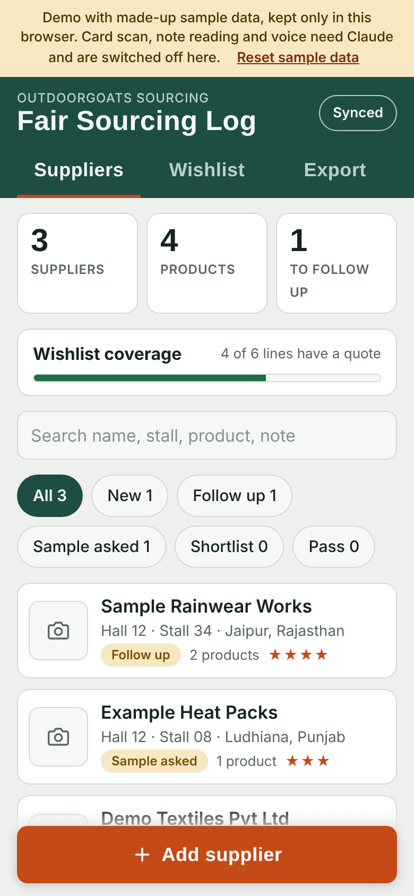
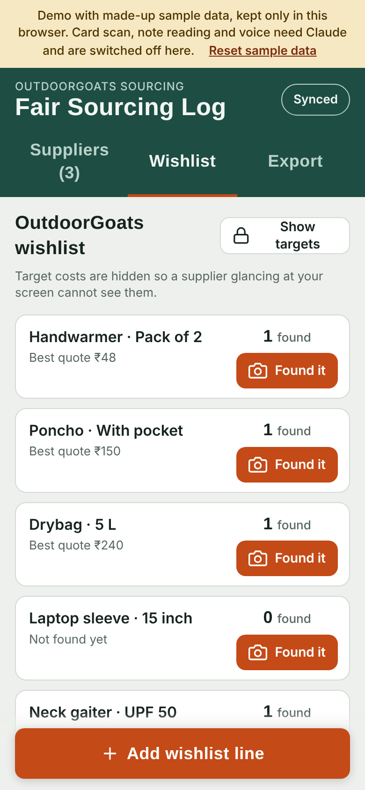
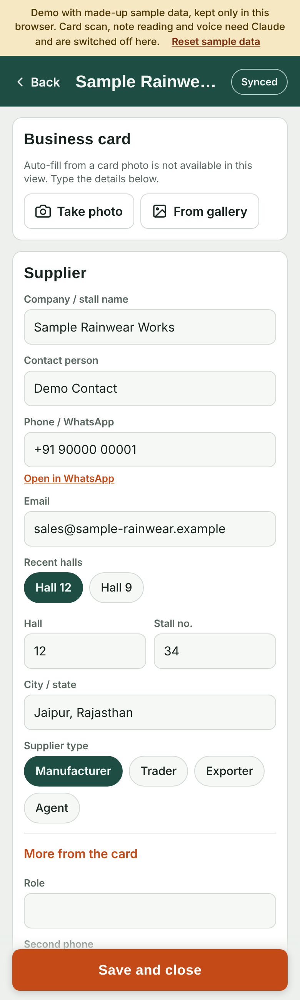
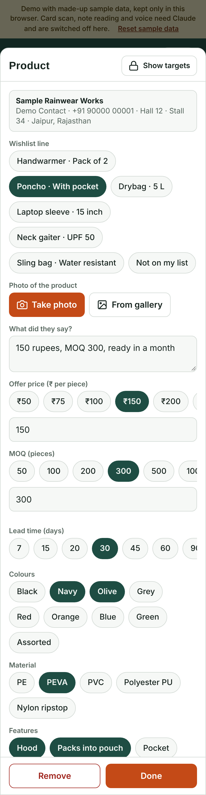

# OutdoorGoats Fair Sourcing Log

A phone-first tool for working a trade fair as a buyer. At each stall you scan the supplier's card, photograph the product, tap the price, MOQ, lead time and features, and move on. Every product is logged against a line on the buying wishlist, so at the end of the day you can see which lines have a quote, which don't, and how each offer compares with target.

I built it for a real sourcing trip: an accessories range for an outdoor retailer, one day, many stalls, no time to fill in forms.

**Try it:** the demo runs in the browser with made-up suppliers and prices. Nothing you enter leaves your device.
`https://manishakat-hub.github.io/outdoor-goat-sourcing/` (once GitHub Pages is switched on for this repo)

| Suppliers | Wishlist | Supplier | Product |
|---|---|---|---|
|  |  |  |  |

## The problem

At a fair, information arrives faster than it can be recorded: a pile of business cards, photos on a phone camera roll, prices said aloud, MOQs scribbled somewhere. Afterwards nobody can compare like with like, and the buying wishlist and the supplier list never meet.

## How it works

- **The wishlist is the spine.** Every wishlist line has a *Found it* button. Tap it, add the supplier (or reuse the one you are standing at), photograph the product and set the offer.
- **Tap, don't type.** Price, MOQ, lead time, colours, material, features, sample status, supplier type and hall are all pre-loaded chips. Material and feature chips change with the wishlist line, so a poncho offers different options from a drybag. The wishlist's own must-haves appear as feature chips. A typing box is there for exact values.
- **One supplier, up to 15 products.** The supplier's details sit at the top of every product screen. Saving a product leaves you on the supplier so the next one is one tap away.
- **Target costs stay hidden.** The wishlist's target costs are covered until you tap *Show targets*, and they re-hide on every screen change, so a supplier glancing at the phone cannot see what you are willing to pay. The price chips are a generic ladder and are not derived from targets.
- **Quotes against target.** With targets shown, each offer is flagged as over, at or under target, and MOQ above the wanted level is called out.
- **Safe by default.** Details read from a card are marked, and a card read never overwrites what you typed. Possible duplicate suppliers (same phone number) are flagged. Edits queue and retry when the signal drops.
- **Export.** One CSV row per product, with supplier, contact, hall and stall, wishlist line, price, MOQ, lead time, colours, material, features, sample status, and notes, ready to sit next to a vendor master.

## Two ways to run it

| | In Claude | Demo on GitHub Pages |
|---|---|---|
| Storage | Shared database that syncs across devices | This browser only |
| Photos | Stored with the page | This browser only |
| Card scan | Claude reads the card photo and fills the form | Off |
| "What did they say?" | Claude fills the chips from a typed or spoken note | Off |
| Voice | Dictation (Chrome-type browsers and the desktop app) | Off |
| Data | Real | Made up |

`index.html` is the same app in both cases. When it is not running inside Claude, `demo-shim.js` supplies a small local stand-in for storage, photos and file saving, and loads sample data. The card-scan and note-reading features call a Claude model and cannot run without one. I have not recorded them here because I do not want to show anything simulated as if it were live.

## Built with

One self-contained HTML file: no framework, no build step, no dependencies. Designed by me and built with Claude (Anthropic). Behaviour was checked with automated tests against simulated services and by rendering the screens at phone width; the test suite is not part of this repo.

Choices worth noting:

- **No forms.** The brief was "I will be standing in an aisle with one hand free", so the interface is chips, photos and a voice note.
- **Privacy before convenience.** Targets hidden by default, card and note text treated as data and never as instructions, and, in the Claude version, a database that only the owner can read.
- **Never lose a capture.** Everything is mirrored on the device first and synced when there is a signal.
- **Everything on screen is escaped**, because supplier names and card text are untrusted input.

## Run it yourself

Open `index.html` in a browser (or serve the folder with any static server, for example `python3 -m http.server`). To publish the demo, turn on GitHub Pages for the `main` branch, root folder.

## Limits

- 15 products per supplier, by design.
- The demo keeps data in the browser, so clearing site data erases it. *Reset sample data* in the banner restores the starting set.
- Photos need a signal in the Claude version.
- Not a vendor master or a PLM tool. It is a field capture tool that feeds one.

All names, phone numbers, prices and wishlist lines in this repo are made up.
